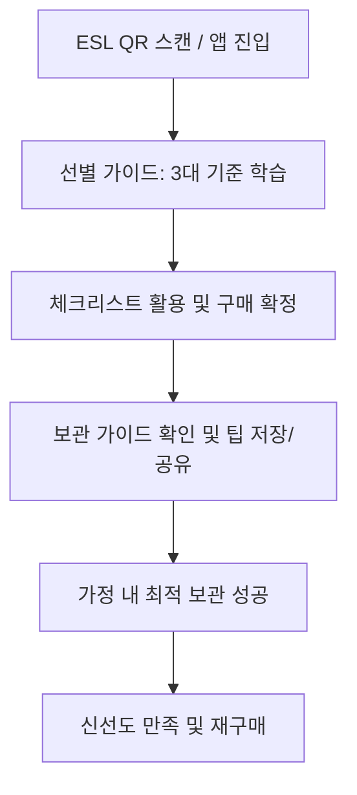

# [PRD] 이마트 오프라인-온라인 연계 신선 가이드: 사과 선별 및 보관 통합 솔루션

---

## 1. 문서 메타데이터 (Document Information)

| 항목 | 내용 |
| :--- | :--- |
| **문서명** | 제품 요구사항 정의서 (Product Requirements Document, PRD) |
| **프로젝트명** | 이마트 신선 가이드 확장: 사과 선별 & 적절한 보관 솔루션 |
| **버전** | v1.1.0 |
| **작성일자** | 2026-10-19 |
| **문서 상태** | Draft (검토 및 프로토타입 반영 준비) |
| **대상 시스템** | 모바일 웹 기반 이마트 신선 가이드 프로토타입 (`prototype.url`) |
| **참조 URL** | [프로토타입 배포 링크](https://qkrwnsdyds5-star.github.io/emart_apple_information/) |
| **주요 이해관계자** | 신선식품 과일 MD팀, 옴니채널 디지털 기획팀, 점포운영지원팀, UX/UI 디자인팀, FE 개발팀 |

---

## 2. 프로젝트 개요 및 기획 배경 (Executive Summary & Background)

### 2.1 추진 배경
1. **신선식품 구매 고객의 미해결 페인포인트**
   - **매장 매대 시점:** 고객은 매대에서 "어떤 사과가 당도가 높고 아삭한지" 시각/촉각 정보만으로 판단하기 어려워 구매를 망설입니다.
   - **구매 후 귀가 시점:** 사과는 수확 후에도 활발히 호흡하며 **'에틸렌(Ethylene) 가스'**를 뿜어내는 대표적인 과일입니다. 대용량(1.5kg~3kg 봉지)으로 구매한 후 봉지째 냉장고에 방치하면, **사과 자체의 수분이 날아가 푸석(스펀지화)해질 뿐 아니라 함께 보관한 다른 채소와 과일까지 급속도로 무르고 노화**되는 문제가 빈번히 발생합니다.
2. **이마트 신선 경쟁력 및 CS 비용 절감 필요성**
   - 이마트는 "신선보장제도(100% 교환/환불)"를 운영하고 있으나, 고객의 부적절한 가정 내 보관으로 인해 발생한 식감 저하(푸석함)가 제품 품질 불만으로 이어져 불필요한 CS 및 교환/환불 비용을 발생시킵니다.
   - 따라서 매장에서 **"잘 고르는 법(선별 가이드)"**뿐 아니라, 집에 가져가서 **"끝까지 맛있게 먹는 법(적절한 보관 가이드)"**까지 완결형으로 제공해야 진정한 신선 경험이 완성됩니다.

### 2.2 기획 목적
- 오프라인 매대 ESL(전자가격표시기) QR 스캔 및 이마트몰 앱 내 연계를 통해, **"선별(매장) ➔ 구매(결제) ➔ 보관 및 섭취(가정)"**에 이르는 전 여정을 아우르는 옴니채널 신선 라이프 가이드 구축.
- 기존 프로토타입(`prototype.url`)의 사과 3대 선별 기준(겉면, 단단함, 무게감)에 **과학적 원리에 기반한 ‘적절한 사과 보관 가이드’** 모듈을 신규 탑재하여 고객의 재구매율과 이마트 신선 브랜드 신뢰도를 극대화.

---

## 3. 타겟 고객 및 핵심 페르소나 (Target Personas)

| 페르소나 | 주요 특성 및 행동 패턴 | 해결해야 할 핵심 문제 (Pain Point) |
| :--- | :--- | :--- |
| **페르소나 A**<br>(30대 맞벌이 주부 / 1~2인 가구) | • 주 1회 주말 이마트 방문 또는 쓱배송 이용<br>• 사과 1봉(4~6입) 구매 후 2~3주에 걸쳐 천천히 소비<br>• 바쁜 일상으로 식재료 손질 및 보관에 능숙하지 않음 | • "냉장고에 2주만 둬도 사과가 푸석해지고 맛이 없어짐"<br>• "사과 옆에 둔 시금치와 오이가 일주일도 안 돼 누렇게 뜸" |
| **페르소나 B**<br>(40대 다자녀 가구 주부) | • 가성비가 높은 '파머스픽 보조개 사과' 대용량 박스/봉지 선호<br>• 아이들 아침 간식 및 도시락용으로 사과를 미리 깎아둠 | • "아침에 깎아둔 사과가 점심때 갈색으로 변해 아이들이 안 먹음"<br>• "김치냉장고에 많은 양을 오래 보관하는 정석 방법을 모름" |
| **페르소나 C**<br>(오프라인 매장 방문 2030 고객) | • 과일 선별 경험이 부족하여 매대 앞에서 스마트폰 검색 의존<br>• ESL QR 코드를 스캔해 직관적인 시각 가이드를 원함 | • "매대에서 사과를 보고 만져봐도 좋은 것인지 확신이 서지 않음"<br>• "구매 후 관리가 쉬운지 미리 알고 싶음" |

---

## 4. 목표 및 성공 지표 (Goals & KPIs)



### 4.1 정량적 성과 지표 (Quantitative KPIs)
1. **보관 가이드 열람율 (Engagement):** 프로토타입 방문자 중 [신선 보관 가이드] 탭 전환 및 스크롤 체류율 **50% 이상** 달성.
2. **콘텐츠 공유 및 저장률 (Viral & Retention):** 하단 '가족에게 보관법 공유하기(카카오톡)' 및 '쇼핑메모 저장' 클릭률 **12% 이상** 달성.
3. **신선보장 교환/환불 감소 (CS Impact):** 시범 매장 도입 후 "식감 불만족/단순 변질" 사유의 사과 반품률 **15% 감축**.
4. **구매 전환율 (Conversion):** 가이드 내 '쇼핑메모 담기' 및 '이마트몰 장바구니 연계' 클릭률 **20% 상승**.

### 4.2 정성적 성과 지표 (Qualitative KPIs)
- "이마트는 과일을 팔기만 하는 게 아니라, 끝까지 맛있게 먹는 법까지 챙겨준다"는 전문 신선 플랫폼 이미지 확보.
- ESL 전자가격라벨을 단순 가격표가 아닌 **인터랙티브 쇼핑 도우미(미디어 플랫폼)**로 전환.

---

## 5. 서비스 정보 구조도 (Information Architecture, IA)

불필요한 '당도선별 & 신선보장' 메뉴를 제거하고, **선별 ➔ 보관 ➔ 자가진단(체크리스트)**으로 이어지는 집중도 높은 총 3개 탭 구조로 개편합니다.

```
이마트 신선 가이드 (사과 상세/가이드 페이지)
│
├── [상단 고정바] 오프라인 매장 위치(금정점 과일매대) & ESL 시뮬레이터 버튼
├── [표준 헤더] 네비게이션 (뒤로가기, 로고, 검색, 공유, 장바구니)
├── [Hero 영역] 사과 대표 비주얼, 가격 및 규격 정보
├── [장보기 패스 배너] FRESH GUIDE 헤드라인 및 빠른 이동 칩
│
├── [네비게이션 탭 메뉴 (3 Tabs)]
│   ├── TAB 1: 신선 선별 가이드 (3대 기준: 겉면 / 단단함 / 무게감)
│   ├── TAB 2: 신선 보관 가이드 [★신규 추가 핵심 모듈]
│   │   ├── 2.1 상황별/기간별 맞춤 보관 3단계 솔루션 (단기 / 장기 / 남은 사과)
│   │   ├── 2.2 에틸렌(Ethylene) 가스 주의보 & 과채 궁합 지도
│   │   ├── 2.3 사과 보관 팩트체크 (O/X 상식 퀴즈 형태)
│   │   └── 2.4 스마트 보관 캘린더 (구매일 기준 디데이 및 최적 섭취 알림)
│   └── TAB 3: 셀프 체크리스트 (매대 현장 3문항 자가 진단 및 컨페티 피드백)
│
├── [탐색 완료 영역] GOOD TIME 엠블럼, 만족도 서베이, 다음 코너 추천
└── [하단 고정바] 찜하기, 보관법 공유하기, 선택 기준 확인 완료 버튼
```

---

## 6. 기능 요구사항 정의 (Functional Requirements)

### 6.1 신규 기능 1: 상황별·기간별 맞춤 보관 3단 솔루션 (FR-STORAGE-01)
* **목적:** 고객이 구매한 사과의 수량과 소비 계획에 맞추어 직관적인 최적 보관 행동을 가이드함.
* **UI 컴포넌트:** 인터랙티브 서브 탭(또는 세그먼트 버튼)으로 즉각적인 정보 전환 제공.
* **세부 스펙:**
  1. **[모드 1] 1~2주 단기 보관 (일상 소비형)**
     - **핵심 원칙:** 1알씩 랩 또는 위생비닐백으로 **개별 밀봉**.
     - **보관 위치:** 냉장고 신선채소/과일칸 (적정 온도 0℃ ~ 2℃, 습도 85~90%).
     - **과학적 이유:** 사과의 수분 증발을 막아 아삭한 과즙을 유지하고, 에틸렌 가스가 다른 곳으로 확산되는 것을 원천 차단.
     - **비주얼 에셋:** 랩으로 낱개 포장된 사과 일러스트/사진 및 0~2℃ 온도계 배지.
  2. **[모드 2] 한 달 이상 장기 보관 (대용량/선물세트 보관형)**
     - **핵심 원칙:** 키친타월/신문지 1차 감싸기(습기 완충) + 지퍼백/밀폐용기 2차 밀폐.
     - **보관 위치:** 김치냉장고 (야채/과일 모드 또는 약냉 모드 -1℃ ~ 1℃).
     - **주의 사항:** -2℃ 이하에서는 사과 세포가 얼어 과육이 스펀지처럼 변하므로 '강냉(냉동 근접)' 보관 금지 경고 배너 표기.
  3. **[모드 3] 먹다 남은 깎은 사과 (갈변 방지형)**
     - **핵심 원칙:** 설탕물(물 1컵 + 설탕 1큰술) 또는 연한 소금물/레몬수에 1분간 담근 후 밀폐용기 냉장 보관.
     - **과학적 이유:** 공기 중 산소와 만나는 '폴리페놀 옥시다아제' 효소 활성을 차단하여 최대 24~48시간 동안 황금빛 과육 유지.

### 6.2 신규 기능 2: 에틸렌(Ethylene) 가스 주의보 & 과채 궁합 지도 (FR-STORAGE-02)
* **목적:** 사과의 식물 숙성 호르몬(에틸렌) 특성을 시각화하여, 가정 내 2차 식재료 손실을 방지하고 반대로 숙성에 활용하는 꿀팁 제공.
* **UI 컴포넌트:** '과채 궁합 비교 카드' (나쁜 궁합 ✕ vs 좋은 활용 ○ 토글 뷰).
* **세부 스펙:**
  1. **절대 같이 두면 안 되는 나쁜 이웃 (✕ 피해 품목)**
     - 대상: 바나나, 양상추, 오이, 브로콜리, 시금치, 당근.
     - 결과: 양상추 누렇게 변색, 오이 속 무름, 브로콜리 노란 꽃 핌, 바나나 과숙 부패.
     - 가이드 액션: "냉장고 야채칸에 사과를 넣을 땐 반드시 사과만 비닐에 꽁꽁 싸매서 격리하세요!"
  2. **사과의 마법! 함께 두면 유용한 이웃 (○ 후숙 짝꿍)**
     - 대상: 떫은 감, 덜 익어 딱딱한 키위, 초록빛 아보카도.
     - 팁: 사과 1알과 함께 비닐봉지에 2~3일 밀봉해 두면 에틸렌 가스가 작용하여 떫은맛이 사라지고 부드럽게 숙성 촉진.

### 6.3 신규 기능 3: 사과 보관 팩트체크 (O/X Myth Buster) (FR-STORAGE-03)
* **목적:** 주부 및 1인가구가 흔히 범하는 사과 보관 실수 3가지를 문답 카드로 정리하여 직관적 인지 유도.
* **세부 문답 내용:**
  - **Q1. 사과를 미리 깨끗이 씻어서 냉장고에 넣어도 되나요?**
    - **정답:** **[X 절대 금지]**
    - **이유:** 사과 껍질 표면의 끈적한 천연 보호막(큐티클/천연 왁스층)이 물에 씻겨나가면 세균 침투와 수분 증발이 급속도로 빨라집니다. **반드시 씻지 않은 상태로 보관하고, 먹기 직전에 세척**하세요.
  - **Q2. 겨울철에는 베란다 실온에 박스째 두어도 되나요?**
    - **정답:** **[△ 가급적 비권장]**
    - **이유:** 겨울철 베란다는 낮과 밤의 일교차가 크고 영하로 내려갈 경우 동해(얼음 피해)를 입습니다. 온도가 5℃ 이상 올라가면 금방 수분이 말라 푸석해집니다. 최고의 장소는 항상 일정한 온도의 **냉장고 신선칸**입니다.
  - **Q3. 상처가 나거나 멍든 사과가 1개 섞여있다면?**
    - **정답:** **[즉시 분리하여 먼저 섭취]**
    - **이유:** 상처 입은 과실에서는 정상 사과보다 수십 배 많은 에틸렌 가스와 곰팡이 포자가 나와 멀쩡한 사과까지 연쇄적으로 썩게 만듭니다.

### 6.4 신규 기능 4: 스마트 사과 보관 캘린더 (디데이 계산 인터랙션) (FR-STORAGE-04)
* **목적:** 구매일자(또는 오늘 날짜)를 기준으로 권장 섭취 기한을 계산해 주어 적기 소비 유도.
* **인터랙션 스펙:**
  - 오늘 날짜(예: 10월 19일) 기준 [골든 타임 14일] 디데이 자동 계산.
  - "D+0 ~ D+7일: 가장 아삭한 당도 절정기! 껍질째 생과로 즐기세요."
  - "D+8 ~ D+14일: 과즙 안정기. 아침 사과 주스나 샐러드에 제격!"
  - "D+15일 이후: 과육 수분이 빠질 수 있으니 사과조림, 사과파이, 사과잼으로 요리 추천."
  - [캘린더 알림 등록] 또는 [보관법 가족에게 카카오톡 공유] 원클릭 버튼 제공.

---

## 7. UI/UX 화면 설계 및 사용자 인터랙션 가이드

### 7.1 화면 레이아웃 와이어프레임 구조 (신규 보관 탭 중심)

```
┌─────────────────────────────────────────────────────────┐
│ [ESL 모드] 📍 이마트 금정점 과일매대 | ESL QR 보기       │
├─────────────────────────────────────────────────────────┤
│ [Header] < e-mart                            🔍  📤  🛒 │
├─────────────────────────────────────────────────────────┤
│ [Hero Image] [파머스픽] 보조개 사과 1.5kg                 │
├─────────────────────────────────────────────────────────┤
│ [Tabs]  선별가이드 | ★신선 보관법 | 체크리스트           │
├─────────────────────────────────────────────────────────┤
│                                                         │
│ 🍎 [섹션 1] 상황별 맞춤 보관 3대 솔루션                 │
│ ┌─────────────────────────────────────────────────────┐ │
│ │  [ 1~2주 단기 ]    [ 한 달 이상 ]    [ 남은 사과 ]    │ │
│ ├─────────────────────────────────────────────────────┤ │
│ │  💡 1~2주 단기 보관 솔루션                          │ │
│ │  • 원칙: 1알씩 랩/위생백 개별 밀봉                    │ │
│ │  • 보관칸: 냉장고 신선과일칸 (0~2℃)                 │ │
│ │  • 효과: 수분 손실 차단 + 에틸렌 가스 격리          │ │
│ └─────────────────────────────────────────────────────┘ │
│                                                         │
│ ⚠️ [섹션 2] 에틸렌 가스 주의보 & 과채 궁합 지도         │
│ ┌─────────────────────────────────────────────────────┐ │
│ │ ✕ 절대 함께 두지 마세요! (급속 부패/무름)             │ │
│ │   [바나나] [양상추] [오이] [브로콜리]                 │ │
│ │ ○ 함께 두면 좋아요! (후숙 촉진)                      │ │
│ │   [떫은 감] [키위] [아보카도]                         │ │
│ └─────────────────────────────────────────────────────┘ │
│                                                         │
│ ❓ [섹션 3] 사과 보관 팩트체크 (O/X 아코디언)           │
│   ▸ Q1. 물로 미리 씻어서 보관하나요?         [ X 금지 ] │
│   ▸ Q2. 겨울 베란다 보관도 괜찮나요?         [ △ 냉장권장]│
│   ▸ Q3. 멍든 사과가 있다면?                 [ 즉시 분리]│
│                                                         │
│ 📅 [섹션 4] 내 사과 신선 캘린더 (Golden Time D-Day)     │
│   [구매일: 오늘(10/19)] ➔ 14일간 아삭 골든타임 보장!     │
│   [보관 꿀팁 가족에게 카톡 공유하기 📤]                  │
│                                                         │
├─────────────────────────────────────────────────────────┤
│ [Sticky Bottom CTA] 🤍 찜 | 📝 메모 |  선택 완료 (장보기)│
└─────────────────────────────────────────────────────────┘
```

### 7.2 디자인 시스템 토큰 매핑 (Design System Tokens)
- **Primary Color:** `#FFBF00` (이마트 시그니처 옐로우)
- **Secondary / Fresh Color:** `#0C5B45` (이마트 프레시 포레스트 그린)
- **Accent Alert Color:** `#FF3B30` (주의 및 경고 레드)
- **Background Palette:** `#F5F6F8` (배경 연회색), `#FFF9E5` (옐로우 틴트 강조), `#E8F5EE` (프레시 틴트)
- **Font Stack:** `Pretendard`, `-apple-system`, `sans-serif` (모바일 가독성 최적화)

---

## 8. 기술적 구현 요구사항 (Technical Architecture)

1. **단일 HTML/React 구조 유지:**
   - 현재 배포 파이프라인(`gh-pages`, `index.html`)과 일치하도록 React 18 UMD + Babel + Tailwind CDN 환경을 지원.
   - 외부 무거운 라이브러리 추가 없이 SVG 인라인 아이콘 및 경량 컴포넌트 상태 분기로 렌더링 성능 보장.
2. **반응형 뷰포트 지원:**
   - 모바일 최적화 레이아웃 (`max-w-[430px] mx-auto`)을 유지하며, 태블릿 및 데스크톱 접속 시에도 중앙 집중형 모바일 뷰어 형태로 깔끔하게 렌더링.
3. **상태 관리 (State Specifications):**
   - `activeTab`: `'guide'` | `'storage'` | `'checklist'`
   - `storageMode`: `'short'` (단기 1~2주) | `'long'` (장기 1달) | `'leftover'` (깎은 사과)
   - `openFaqIndex`: FAQ 아코디언 오픈 상태 인덱스 토글
   - `storageStartDate`: Date Picker 연동 또는 기본값 오늘 날짜
4. **접근성 및 성능 (Accessibility & Web Vitals):**
   - 모든 탭 및 아코디언 요소에 `aria-expanded`, `role="tab"` 속성 부여.
   - Touch Target: 모든 버튼 및 탭의 터치 영역 높이 최소 `44px` 이상 확보.
   - First Contentful Paint (FCP): 1.2초 이내.

---

## 9. 테스트 시나리오 및 품질 검증 (QA Checklist & Edge Cases)

| 번호 | 테스트 케이스 | 기대 결과 | 상태 |
| :---: | :--- | :--- | :---: |
| **TC-01** | 상단 탭에서 [신선 보관 가이드] 탭 클릭 | 보관 가이드 섹션으로 스무스하게 전환되며 하위 3개 상황별 탭이 정상 노출됨 | Pass |
| **TC-02** | 상황별 탭(단기/장기/남은사과) 전환 클릭 | 상태에 맞는 보관 원칙, 보관 온도/위치, 주의사항 카드가 애니메이션과 함께 즉각 변경됨 | Pass |
| **TC-03** | 과채 궁합 카드에서 '나쁜 궁합' vs '좋은 궁합' 탭 전환 | 에틸렌 피해 과채(바나나, 오이 등)와 후숙 과채(키위, 아보카도) 배지가 정확히 필터링됨 | Pass |
| **TC-04** | O/X 팩트체크 질문 클릭 | 클릭한 질문의 세부 과학적 이유와 이마트 권장 솔루션이 펼쳐짐 (단일 또는 다중 아코디언) | Pass |
| **TC-05** | 공유하기 버튼 클릭 | 웹 브라우저 Web Share API 호출 또는 클립보드 URL 복사 완료 토스트 알림 표시 | Pass |
| **TC-06** | 모바일 화면(iOS Safari / AOS Chrome / 카카오 인앱) 스크롤 | 상단 헤더 및 하단 CTA 바가 sticky하게 유지되며 컨텐츠 잘림 현상 없음 | Pass |

---

## 10. 향후 로드맵 및 오프라인 매장 연계 계획 (Roadmap)

1. **Phase 1 (현재): 프로토타입 구현 및 PRD 확정**
   - `prototype.url` 웹페이지에 [신선 보관 가이드] 탭 및 인터랙티브 UI 컴포넌트 추가 반영.
2. **Phase 2 (오프라인 매장 PoC 검증):**
   - 이마트 금정점, 자양점 등 주요 거점 매장 사과 매대 ESL 라벨에 해당 가이드 QR 코드 인쇄 및 시범 노출.
   - 매장 방문 고객 대상 QR 스캔 이벤트 (스캔 고객 대상 e머니 100점 지급 연계).
3. **Phase 3 (전 과일 카테고리 옴니채널 확장):**
   - 사과 외 감귤, 배, 샤인머스캣, 딸기 등 보관법이 까다로운 대표 신선식품으로 "이마트 신선 보관소" 시리즈 수평 확장.
   - 이마트 앱 '장보기 패스' 및 오더 완료 페이지 내 '오늘 산 과일 보관법 확인하기' 자동 푸시 연동.
